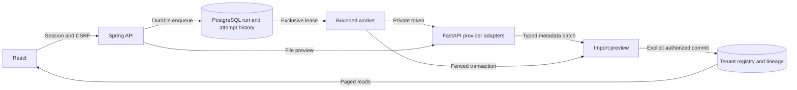

# Step 10 implementation and verification report

Verification date is November 10, 2026 (Asia/Kolkata).

## 1. Acceptance status

Step 10 completion code is implemented on the existing Spring, PostgreSQL, FastAPI
and React stack. Discovery now runs in a durable PostgreSQL queue. The registry
uses bounded pages, Formula Studio can edit drafts and compare versions, and asset
curation has separate technical and business owners, team ownership, tags and
history. The existing manual workflow and Step 08 CSV import remain available.

Automated and isolated HTTP checks passed. The development V5 schema and
history were restored on a disposable database and upgraded to V10 with all
15 original table fingerprints intact. **Final acceptance remains open.** Work
settings blocked the V10 browser rerun, and development migration and smoke
checks await the operator. All four adapters remain LIVE UNVERIFIED. The
development database still reports V1–V5. See the [manual browser script](browser-acceptance.md)
and [operator rollout](operator-rollout.md).

## 2. Original connection failure

The actual authenticated Connections page displayed only its heading when the
organization had no writable team. The creation form was silently hidden behind
a team check. The processor was also not listening on port 8000, so CSV preview
could not work. Existing APIs were limited to Snowflake CSV and lacked live
configuration/test/discovery/edit operations. Import selection did not filter
unwritable sources. See [pre-change diagnosis](connection-diagnosis.md).

The replacement Connections page exposes loading/errors, a team setup path,
explicit source types, saved details and authorized operations. Import selection
is permission-aware. Ownership/RLS checks remain enforced on the server. A backend
version check gives a rollout-required message when the new frontend meets an
old backend, rather than pretending a manual source was created by the old API.

## 3. Existing infrastructure preserved

Existing BCrypt sessions, CSRF, organization switching, team RBAC, transaction-local
tenant selection, restricted roles, forced RLS, audit events, legacy CSV semantics
and natural-key UUID reconciliation continue to apply. The acceptance database
upgraded from V8 to V10 in place. A pre-existing asset UUID remained accessible
after the upgrade and a subsequent backend restart.

All eight pre-existing migration files passed SHA-256 verification against the
[pre-completion manifest](v1-v8-preserved.sha256).

## 4. New migrations

V7 established encrypted connector secrets, acquisition history, mapping profiles,
formula and metric snapshots, and persisted lineage provenance. V8 added
tenant-keyed formula column references.

V9 extends the existing sync runs in place with durable status, cancellation,
retry scheduling and leases. It adds attempt history and a partial unique index
for one active run per connection. Claim uses `FOR UPDATE SKIP LOCKED`, and
finish requires the current lease owner and token. Dispatcher functions have a
fixed search path and restricted execution grants. Cross-tenant dispatch visibility
is confined to the queue envelope. Worker reads and preview writes use fresh
organization and team checks inside the ordinary tenant transaction.

V10 adds asset business ownership, organization tags, append-only curation
history, draft revisions and browse indexes. The new tenant tables have forced
RLS and composite tenant foreign keys. Existing registered versions remain frozen.

## 5. Architecture



The worker fetches provider metadata outside the tenant transaction. It checks the
initiator's current access and the connection configuration again when storing the
preview. The preview and successful run outcome commit atomically. Late results
from a superseded lease cannot publish.

## 6. Connection management and discovery

Create, list, edit, transfer owning team, enable or disable and rotate credentials.
Test performs a provider-specific metadata access check. Discover returns HTTP
202 with a persisted PENDING run. Discovery history reports current phase, attempts,
retry time, cancellation, warnings, errors, record count and preview link.

Two workers per process are enabled by default. A lease expiry recovers the same
run and records the interrupted attempt. Transient errors retry up to three total
attempts with exponential backoff and jitter. Credential, permission and
configuration failures are terminal. Cancelling queued work stops it immediately.
Cancelling an active run fences preview publication. Retry creates a fresh run
while retaining the prior history. Canonical metadata is written only by the
authorized import commit.

## 7. Connector capabilities

| Provider | Implemented | Limits |
|---|---|---|
| Snowflake | Key-pair auth; INFORMATION_SCHEMA columns/tables/views metadata, comments, owner, nullability/ordinal; optional accessible view definitions | One configured database; schema allowlist; 20,000 columns; no business rows/query-history lineage |
| S3 | Explicit scoped credentials; ListObjectsV2 pagination; keys,size,modified,ETag; empty/partial/error outcomes | 1,000 objects; no body download, custom object metadata, versions or schema guessing |
| GitHub SQL | Commit resolution, tree and SQL blobs; source/path/commit/blob evidence; SQL parsing | 100 files maximum, 100 KB/file, 2 MB total; truncated tree reported |
| Power BI | Entra client credentials plus actual configured workspace access; reports/models, returned owner/refreshability fields; resolvable report.datasetId relationships | Ten workspaces; no ordinary REST claim for visual/DAX extraction, admin scanning or XMLA |

Setup, exact credential/configuration fields and provider documentation are in
[connectors and imports](connectors-and-imports.md).

## 8. Credential handling

AES-256-GCM; externally supplied random 32-byte key; fresh 96-bit nonce; org/connection/
version authenticated binding; separate RLS-protected secret relation; key version
metadata; no credential reads through ordinary APIs. Rotation preserves catalog
records. Configuration rejects undocumented fields. Missing encryption configuration
fails closed for secret operations while browsing/manual workflows remain usable.

Tests cover nonces, round trip, ciphertext tampering, wrong organization/connection
binding, unavailable/weak keys, response redaction and credential rotation.
There is no bulk encryption-key migration facility; preserve the configured key.

## 9. Manual imports

Original Snowflake CSV; arbitrary-header generic CSV; S3 inventory CSV; versioned
metadata JSON; SQL; safe SQL ZIP; Power BI asset inventory CSV and reporting mapping
CSV. Actual headers/data drive preview. Named field mappings are persisted per
connection/organization. Comparison counts and commit results come from real
registry state. Commit retries are idempotent; partial uploads preserve omitted
columns and manual curation. Imported reporting declarations produce real stored
relationships, while unresolved metric names require explicit version selection.

## 10. Manual registration and curation

Manual registration supports FILE, DATASET, TABLE, VIEW, SQL_TRANSFORMATION,
SEMANTIC_MODEL, REPORT, VISUAL, MEASURE and WORKSPACE. Columns remain child
records. Catalog detail exposes separate imported source metadata and manually
curated names, descriptions, technical owner, business owner, owning team and tags.

Asset edits use revision checks. Organization owners and admins create scoped
tags, and users with write access to the asset can assign them. Owning team
transfer uses the existing explicit authorization path and advances the asset
revision. Curation history records the actor, time, field changes and tag
additions or removals. Reconciliation preserves the curated fields and IDs.

## 11. SQL parser

SQLGlot AST parsing for snowflake,postgres,tsql,bigquery,mysql,sqlite,spark,duckdb.
Handles source table candidates through aliases, CTEs and JOINs; supported CTAS,
CREATE VIEW and INSERT target forms; column-reference candidates. Invalid syntax,
macros and unsupported commands have explicit states/warnings. SELECT does not
invent an output target. SQL is never executed. Automatic resolved column-lineage
publication is not implemented: users explicitly confirm existing endpoint
identities in mapping forms; those edges are correctly labeled manual declarations.

## 12. Lineage mapping

Stored dataset and column dependencies; multiple source columns can map to one
target through separate edges. Backend verifies existing endpoints, tenant/team
rights, supported direction/types, duplicate active edges and prohibited cycles.
A transaction-scoped advisory lock serializes manual cycle checks and writes.
Revoke/supersede retains history. Imported reporting edges preserve imported/live
acquisition provenance. Graph supports upstream/downstream/both, depth 1–5,
100 nodes/200 edges, truncation and click-through. Potential impact uses actual
records, including formula dependencies and specific metric-version report usage.

## 13. Formula Studio

CodeMirror provides SQL syntax highlighting, multiline editing, undo and keyboard
navigation. DAX and business rules are editable as text with basic text and size
checks. SQL is parsed without execution. Users select explicit asset and column
references and can save a draft, update that draft with a revision check, or
register an immutable expression version. Updating a draft replaces its explicit
references in the same transaction. History supports side-by-side comparison and
added or removed expression lines. Registered snapshots can be reused as input
for a new version. Navigation, organization switching, sign-out and page unload
protect unsaved expression changes.

## 14. Metrics

Stable uppercase business key; definition, unit, aggregation, grain and descriptive
owners/team. Immutable numbered metric versions reference actual REGISTERED formula
versions. Users map specific metric versions to reporting assets/measures. Usage
and formula dependency evidence appear in lineage. REGISTERED is not approval or
deployment, and external systems are never rewritten when a definition changes.

## 15. Frontend and pagination

Connections, assets, imports, formulas, metrics, teams and lineage listings expose
stable pages, scoped filters and total counts. Histories for attempts, versions,
mappings and asset curation use the same browse contract. Lists show loading,
empty and error states. Registry page size is 25 in the UI and at most 100 per API
request. Option selectors load bounded pages with an explicit error at their
10,000-item limit. Team and connection context disambiguate registry choices.
Lineage displays the applied traversal bounds and any truncation.

## 16. API reference

See [methods, paths, DTOs, permissions and errors](api.md). Legacy connection create
and Snowflake CSV paths remain compatible. No privileged processor endpoint is
called directly from the unauthenticated browser. Generic private parsing requires
the configured processor token.

## 17. Automated and packaged-app verification

| Check | Result |
|---|---|
| Maven package with isolated PostgreSQL 16.15 on 55434 | 76 passed, 0 failures, 0 errors, 0 skipped |
| Backend suite breakdown | 59 PostgreSQL integration, 9 tenant configuration, 4 processor client, 4 encryption |
| Python unittest discovery | 96 passed |
| Frontend | TypeScript/Vite production build and oxlint passed |
| Existing migration checksums | V1–V8 matched |

PostgreSQL regression covers exclusive lease claims, stale-worker fencing, retry
and cancellation, access revocation, interrupted acquisition and recovery,
review before commit, stable asset IDs, tenant isolation, draft conflicts,
registered snapshot protection, and preservation of curated ownership during
reimport. Tests page 125 connections, assets, imports, formulas, metrics and teams
with stable IDs and tenant isolation. Existing authentication, CSRF, Snowflake CSV
and metadata import regressions also pass.

Each provider has controlled tests for success, empty and partial inventories,
credentials, permissions, throttling, timeouts, malformed responses and
redaction. Snowflake, S3 and Power BI exercise pagination. GitHub exercises
truncated tree handling. The common application queue tests run interruption,
cancellation, retry, cross-organization denial and repeated discovery for each
configured provider type.

The packaged isolated application returned a PENDING run in 12 ms, created a
reviewable preview and changed the catalog only after explicit commit. A
controlled GitHub response exercised RETRY_WAIT and a successful second attempt.
A running request was cancelled without a preview, and its manual retry completed
as a new run. Five pages returned 125 distinct filtered connection IDs. A request
without CSRF received HTTP 403. Through the Vite proxy a team viewer could read
a source and received HTTP 403 on discovery, connection edit and asset creation.
A real process restart during discovery recovered the same run ID, recorded the interrupted first attempt and produced one preview.
The previously registered asset UUID remained accessible.

The smoke run used Spring on 18081, FastAPI on 18000 with the explicitly labeled
GitHub fixture, and PostgreSQL on 55433. See [machine-readable results](verification-results.json).

## 18. Browser verification

The earlier Step 10 browser run exercised React on 15173 against actual Spring,
FastAPI and isolated PostgreSQL. During the final acceptance audit, browser
inventory returned “Local browser use is disabled in Work settings.” The existing
isolated stack and fixtures are available. Health returned UP, the isolated
organization for team setup had zero teams, and the paging fixture held 125
rows. Those were readiness checks. Zero of the 18 V10 browser steps were run in
this audit. The [manual acceptance script](browser-acceptance.md)
gives each action, expected result and evidence to capture. Prior browser
evidence and V10 HTTP checks are separate results.

| Required browser workflow | Evidence |
|---|---|
| Login and organization selection | Passed in the earlier browser run |
| Team creation with no writable team | Passed in the earlier browser run |
| Connection creation and editing | Passed in the earlier browser run |
| Manual asset and column creation | Passed in the earlier browser run |
| Generic CSV and JSON upload, preview and commit | Generic CSV passed in the earlier browser run. V10 CSV and JSON browser checks are pending. |
| Original Snowflake CSV | Earlier browser run committed two datasets and five columns. Repeat import preserved them. |
| SQL formula creation and versioning | Earlier browser run registered two versions, including an explicit source column reference. V10 editing and comparison need browser verification. |
| Dataset and column mapping | Passed in the earlier browser run |
| Metric version to report mapping | Passed in the earlier browser run |
| Lineage visualization | Earlier browser run showed four nodes, three asset or metric edges and one column dependency. |
| Background discovery | Packaged V10 HTTP passed. Browser pending. |
| Cancellation and retry | Packaged V10 HTTP passed. Browser pending. |
| Pagination beyond 100 | Packaged V10 HTTP passed across five pages. Browser pending. |
| Restart persistence | Earlier browser run verified saved records after signing back in. The V10 process restart and queue recovery passed through HTTP. |
| Ownership and tags | V10 isolated API regression passed. Browser pending. |
| Permission denial | Packaged V10 HTTP verified viewer denials through Vite. Browser pending. |
| Cross-organization isolation | Automated HTTP and PostgreSQL checks passed. Browser pending. |

Earlier screenshots show [lineage](lineage-browser.jpg), [Snowflake CSV](snowflake-import-browser.jpg)
and [registered formula versions](formula-browser.jpg).

## 19. Provider verification

| Provider | Status |
|---|---|
| Snowflake | Implemented, LIVE UNVERIFIED |
| Amazon S3 | Implemented, LIVE UNVERIFIED |
| GitHub SQL | Implemented, LIVE UNVERIFIED |
| Power BI | Implemented, LIVE UNVERIFIED |

Verification used deterministic simulations and test-only credentials. Authorized
vendor credentials and live run evidence are required to change the status.
Provider capabilities and scope limits are documented in the
[connector guide](connectors-and-imports.md).

## 20. Database migration state and audit

| Instance | PostgreSQL | Successful Flyway history | Purpose |
|---|---|---|---|
| 5433, `trace` | 16.15 | V1–V5 | Persistent development, inspected read-only |
| 55433, `trace_tenancy_test` | 16.15 | V1–V10 | Existing isolated browser/HTTP acceptance |
| 55434, `trace_tenancy_test` | 16.15 | V1–V10 | Disposable backend regression |
| 55435, `trace_rollout_audit` | 16.15 | V1–V5 restored, V6–V10 applied successfully | Schema-only rehearsal with synthetic records |

The [Flyway manifest](migration-history.tsv) records order, filenames and
checksums. The local V1–V8 SHA-256 baseline matched. Applied V1–V5 checksums
matched development history. The V10 manifest matched the final JAR's rehearsal
history and the isolated acceptance history.

| Version | Audit result |
|---|---|
| V1 | Core source, asset, column and lineage tables. |
| V2 | Organizations, memberships and teams. Existing rows receive tenant keys and composite foreign keys. |
| V3 | Tenant-local organization lookup, forced RLS and scoped runtime grants. |
| V4 | Import comparison, commit results and source provenance links. |
| V5 | Existing administrator and credential schema, authentication and authorization functions, audit and restricted identity writes. |
| V6 | Local registration through a restricted SECURITY DEFINER function. It inserts a normal USER, credentials and audit event together. |
| V7 | First-layer integration schema, encrypted connection secrets, imports and lineage provenance, formula and metric versions, and report mappings. New active lineage indexes require unique existing groups. |
| V8 | Tenant-keyed formula column references and dependency permissions. |
| V9 | Durable run and attempt history, retry and cancellation state, leases, fenced dispatch and worker grants. |
| V10 | Curated business ownership, tags and change history, draft revisions, and browse indexes. |

**V5 upgrade rehearsal.** Exported only the actual development public schema
with grants and ownership, plus Flyway history rows. Restored both into
a separate tmpfs PostgreSQL 16.15 instance on 55435 and populated synthetic
administrator, credentials, organizations, members, team and team members,
source, committed import, assets, columns, dataset and column mappings, and
audit history. The final JAR's `--migrate-only` validated existing checksums and
applied V6, V7, V8, V9 and V10 in order using the restricted migrator. The
[read-only fingerprint query](rollout-fingerprints.sql) produced identical
counts and digests for all 15 V5 table projections, including original IDs,
credential rows and import links. A full dump from the rehearsal database
passed archive listing and a complete archive read.

**Permissions and smoke.** The migration-only runtime guard passed. All 26
tenant tables had forced RLS. Runtime had no schema creation, direct user or
credential table access, direct run UPDATE, role membership or tenant table
TRUNCATE privileges. The six inspected registration and discovery entry points
had fixed search paths, migrator ownership and restricted execute grants.
As `trace_runtime`, the rehearsal catalog returned zero assets without a tenant,
two in the owning scope and zero in the other scope. Through the actual HTTP API,
the pre-upgrade synthetic administrator logged in using the same credentials,
retained Platform access and opened the original asset UUID. Local Sign Up
created an ordinary account that could sign in and had no organization access.

**Separate V8 upgrade finding.** In a second isolated database, a seeded legacy
synchronous RUNNING job remained RUNNING with no lease after migration to V10.
The claim function returned zero jobs. V9 performs the recovery update before
adding the dispatcher policy, and forced RLS hides legacy rows from that update
without a tenant scope. A populated V7/V8 deployment with in-flight legacy
discovery requires separate handling before rollout. This case cannot occur
when upgrading from V5 because V7 creates the run table. The applied migrations
were left intact. The existing 55433 acceptance database had zero unleased
RUNNING rows at inspection. The disposable 55435 rehearsal was stopped after
verification.

**Development rollout.** The real database had no duplicate dataset or column
lineage groups that would block V7. V6–V10 remain pending. The full development
backup, operator migration, restarts and real administrator smoke checks are
pending. The existing 8081 process was found to use the build target JAR path
after the package command had refreshed that artifact. A subsequent read-only
health request returned HTTP 500. There was no pre-build health result for
comparison. The process was left running and the Flyway state remained V5.
The [rollout guide](operator-rollout.md) places the build after service stop.

## 21. Operational limits and open gates

- Final V10 browser acceptance is pending. Use the manual script if browser
  automation remains unavailable. Development backup, migration, restart and
  operator smoke checks are also pending.
- The separate V8 probe found a stuck legacy RUNNING discovery without a lease.
  The verified V5 development path starts with no discovery run table.
- Each provider remains live unverified. Snowflake supports one configured
  database, S3 lists objects only, GitHub is limited to SQL within the configured
  repository scope, and Power BI does not acquire visuals, DAX, XMLA/TMDL or
  admin and refresh-history data.
- Discovery is user initiated. An upstream call may continue until its deadline
  after cancellation. Lease fencing prevents a late result from publishing.
- Import previews expire after 24 hours. Browse statements have a five-second
  budget and offset pages may shift when another user writes concurrently.
  Graphs cap traversal at five levels, 100 nodes and 200 edges. Large expression
  comparisons use a labeled positional line comparison.
- SQL extraction provides candidates for supported syntax. Explicit mappings
  resolve ambiguous references. DAX validation does not execute Power BI.
- Sessions are process local. A restart requires a new sign-in. Bulk encryption
  key migration and scheduled discovery are outside the current implementation.

## 22. Reproduction

Use the [operator rollout guide](operator-rollout.md) for development and the
[connector guide](connectors-and-imports.md) for templates and private configuration.
The reset-based regression suite must target a specifically disposable database.

```sh
docker compose -p trace-tenancy-verification -f docker-compose.tenancy-test.yml up -d --wait
export JAVA_HOME=$(/usr/libexec/java_home -v 21)
(cd backend && TRACE_TEST_ADMIN_URL=jdbc:postgresql://localhost:55433/trace_tenancy_test ./mvnw package)
(cd processor && .venv/bin/python -m unittest discover -s tests -v)
(cd frontend && npm run build && npm run lint)
```

Use a fresh disposable instance or stop acceptance services and intentionally
discard only the isolated fixture database before using that reset command.
The acceptance server is available at [isolated TRACE](http://127.0.0.1:15173/)
with Spring on 18081, FastAPI on 18000 and PostgreSQL on 55433. Normal operator
startup uses `app:app`. The controlled processor entry point is reserved for
acceptance.
